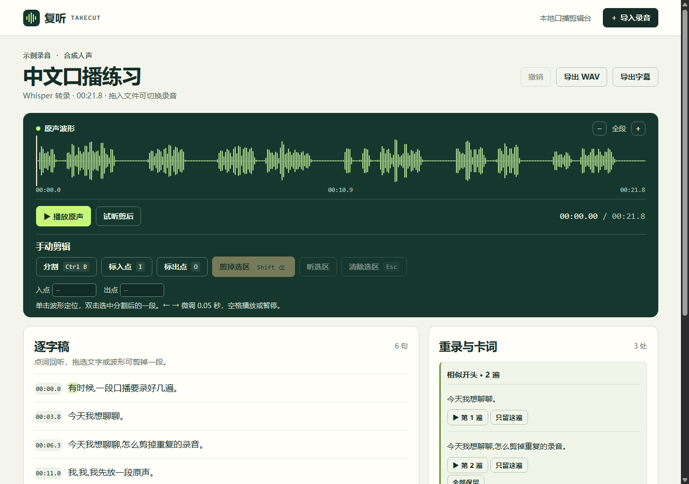

# Takecut (复听)

[中文说明](README.zh.md)

A local, transcript-driven audio editor for solo Chinese voice-over creators. Drop in a raw recording, listen to each retake side by side, keep the best one, tighten the pauses, and export a clean WAV plus a matching SRT subtitle file. Everything runs on your own computer.

Built for the Devpost hackathon **Build Your First AI App 2026**.



## Problem, solution, and who it helps

**The problem.** When you record a voice-over alone, you rarely get a line right on the first try. You restart the sentence, stumble on a word ("我，我，我…"), or leave long gaps while you think. Cleaning this up in a general video editor means scrubbing a waveform by ear, finding each false start, cutting it, closing the gap, and then re-timing your subtitles by hand. For a ten-minute script this can take longer than the recording itself.

**The solution.** Takecut transcribes the recording locally with Whisper and gives you word-level timestamps, so you can edit the audio by editing the text:

- It groups lines that start the same way and shows them as "takes" of one sentence. You audition each take and click **Keep this take**; the others are cut.
- It flags stuttered, repeated words and lets you cut the extra copies or keep them for emphasis.
- You can still cut by hand on the waveform, mark in/out points with keyboard shortcuts, and insert or adjust pauses ("breaths").
- Playback skips the cut ranges, so you always hear the edited result. The exported WAV and SRT use the same edit list, so the subtitles line up with the edited audio without re-timing.

**Who it helps.** Solo creators who record Chinese voice-overs for videos, podcasts, courses, or social media: people who do several takes per line and want a quick first rough cut before moving into a full editor. Because the model runs offline, it also suits anyone who doesn't want to upload unreleased recordings to a cloud service.

## Features

- **Local transcription** with word-level timestamps (faster-whisper, `small` model, CPU int8).
- **Retake review**: lines with a shared opening are grouped; play each take, keep one, or keep all.
- **Repeated-word review**: stutters like "我，我，我" are flagged; cut the repeats or keep them.
- **Transcript editing**: click a word to hear it, click a timestamp to hear the whole line, drag across words to select a range.
- **Waveform editing**: click to place the playhead, drag to select, zoom up to 64×, fine-tune in/out points in seconds.
- **NLE-style shortcuts**: `I` / `O` mark in and out, `Shift+Backspace` ripple-deletes, `Ctrl+B` splits, `/` auditions the last cut, `Ctrl+Z` undoes.
- **Pause control**: insert a 0.2 / 0.4 / 0.8 s (or custom) silence at the playhead, resize it with a slider, loop-audition it, or replace an existing pause in the recording with a pause of a set length.
- **Playback that skips cuts**: Play, line playback, and selection playback all jump over cut ranges and play inserted pauses. The clock shows time on the edited timeline.
- **Export**: 44.1 kHz 16-bit WAV with 3 ms fades at each cut, and an SRT whose cue times follow the edits and split at inserted pauses.
- **Non-destructive**: the original file is never changed; edits are saved in the browser and restored on reload.

## AI implementation

- **Speech recognition: Whisper (`small`, multilingual)** via [faster-whisper](https://github.com/SYSTRAN/faster-whisper). This is the only machine-learning model in the app. The local Python server decodes the upload with FFmpeg to 16 kHz mono and runs `WhisperModel("small", device="cpu", compute_type="int8")` with `language="zh"` and `word_timestamps=True`. The output (a list of words with start and end times) drives the transcript, every click-to-play action, the suggestions, and the subtitle timing.
- **Retake and repeated-word detection: heuristic rules, not AI.** They run in the browser on top of Whisper's output:
  - *Retakes*: the transcript is split into lines at sentence punctuation, long gaps, or length limits. Consecutive lines are grouped as takes when their normalized text shares a common prefix of at least 3 characters and at least 45% of the shorter line, and they are less than 4 seconds apart.
  - *Repeated words*: consecutive identical short words (up to 4 characters) less than 0.85 s apart are flagged if the word is longer than one character, repeats three or more times, or is separated by a comma or a pause.
  - These rules miss retakes where the wording changed a lot, and Whisper sometimes smooths over stutters or picks a wrong homophone. That's why every suggestion needs your confirmation and the waveform tools are there for anything the transcript missed.
- **Audio editing** is plain signal processing in the browser (Web Audio API): kept ranges are concatenated sample-accurately, inserted pauses are silence, and each cut gets a short fade to avoid clicks.

## Setup

Requirements: **Python 3.10+**, **FFmpeg and FFprobe** on your `PATH`, and a modern desktop browser. Takecut was developed and tested on Windows; the server is plain Python, so it should also run on macOS and Linux, but that hasn't been tested. The first install and the model download need internet access; after that, editing works offline.

```powershell
py -3 -m pip install -r requirements.txt
py -3 -c "from faster_whisper import WhisperModel; WhisperModel('small', device='cpu', compute_type='int8')"
py -3 server.py --open
```

(On macOS/Linux use `python3` instead of `py -3`.)

The app opens at `http://127.0.0.1:8769/`. If that port is taken, run `py -3 server.py --port 8770 --open`. On Windows you can also double-click `start.cmd`. The server only listens on `127.0.0.1`, and uploaded audio goes to a temporary folder that is deleted when the server stops.

The bundled demo opens even before the Whisper model is installed.

## How to try it

The home page loads a 22-second synthetic Chinese voice-over with two retakes and a stutter.

1. In **重录与卡词** (Retakes & stutters), play take 1 and take 2 of "今天我想聊聊", then click **只留这遍** (Keep this take) on the more complete one.
2. For "我，我，我", click **剪掉前面的重复** (Cut the repeats). For "非常，非常重要", click **全部保留** (Keep all), since that repetition is intentional emphasis.
3. Click **试听剪点** (Audition cut) to hear both sides of the last cut, or press `/`.
4. Place the playhead at a cut, open **气口** (Pauses), choose 0.4 s and click **插入气口** (Insert pause). Click the purple marker to resize or loop it.
5. Press **Space** to play: the playhead jumps over the red cut ranges and the clock keeps counting through the pause.
6. Click **导出 WAV** and **导出字幕** to download the edited audio and its SRT.

To try your own recording, click **＋ 导入录音** (Import) or drag a WAV/MP3/M4A file onto the page (up to 15 minutes and 128 MiB).

### Keyboard shortcuts

| Key | Action |
| --- | --- |
| Space | Play / pause |
| ← / → | Pause and nudge the playhead by 0.05 s |
| I / O | Mark in / out at the playhead |
| Ctrl+B | Split at the playhead |
| Shift+Backspace or Shift+Delete | Cut the selection and close the gap |
| / | Audition the most recent cut |
| Esc | Clear the selection |
| Ctrl+Z | Undo |

## Your contribution

I was responsible for the requirements, the workflow design, and testing. I defined the problem from my own voice-over work, decided how reviewing retakes, cutting, pauses, and export should fit together, chose which editing conventions to borrow from DaVinci Resolve, and tested each version on real recordings, reporting bugs and UX problems back.

Most of the code was generated by AI coding assistants: **OpenAI Codex** and **Anthropic Claude** (Claude Code). They wrote the Python server, the browser editor, the heuristic suggestion rules, and the export logic from my specifications and feedback.

## Credits

- [Whisper](https://github.com/openai/whisper) and [faster-whisper](https://github.com/SYSTRAN/faster-whisper) for speech recognition.
- [FFmpeg](https://ffmpeg.org/) for decoding.
- The in/out and ripple-delete shortcuts follow the [DaVinci Resolve Beginner's Guide](https://documents.blackmagicdesign.com/UserManuals/DaVinci-Resolve-17-Beginners-Guide.pdf).
- The demo audio was generated with a Windows Chinese text-to-speech voice; its transcript comes from running local Whisper on that audio.
