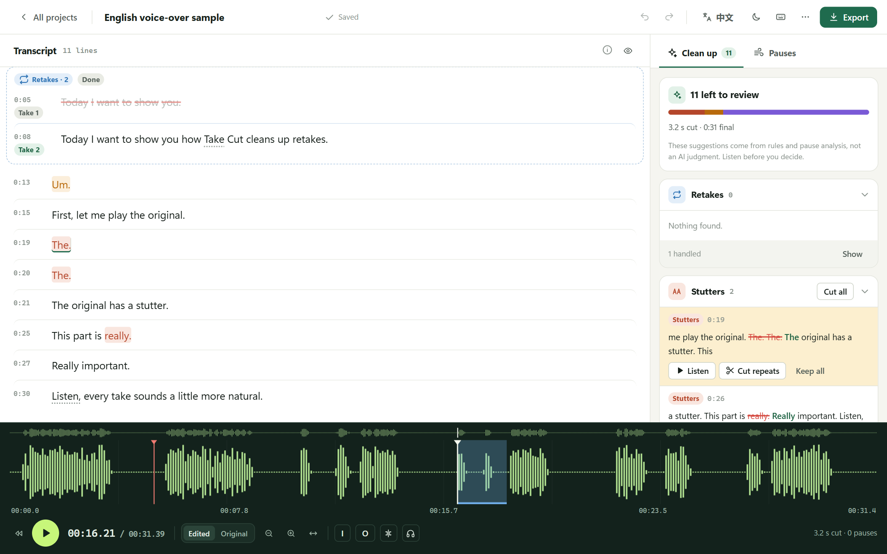
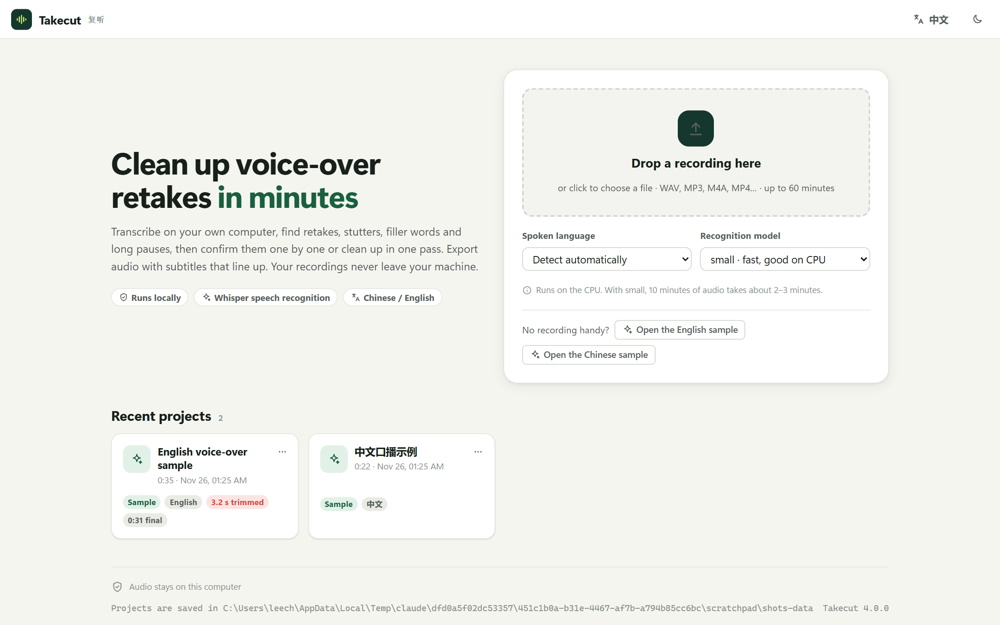

# Takecut (复听)

[中文说明](README.zh.md)

A local, transcript-driven editor for solo voice-over recordings. Drop in a raw take, and Takecut transcribes it on your own computer, finds the retakes, stutters, filler words and long pauses, and lets you clean them up one by one or in one pass. Then export the audio with subtitles that line up. Your recordings never leave your machine.

Built for the Devpost hackathon **Build Your First AI App 2026**.



## Problem, solution, and who it helps

**The problem.** When you record a voice-over alone, you rarely get a line right on the first try. You restart the sentence, stumble on a word ("I, I, I…"), say "um", or leave long gaps while you think. Cleaning this up in a general video editor means scrubbing a waveform by ear, finding each false start, cutting it, closing the gap, and then re-timing your subtitles. For a ten-minute script that can take longer than the recording itself.

**The solution.** Takecut turns the recording into a transcript with word-level timing, so you edit the audio by editing text:

- **Clean up** gathers everything that probably needs cutting into four lists: retakes, stutters, filler words and long pauses. Each item has *Listen*, *Apply* and *Ignore*, and each list has a one-click action.
- For a **retake** you hear each take and pick one (the last complete take is recommended). Restarts inside one sentence are caught too.
- **Long pauses** are shortened to a length you choose, keeping the room tone so joins still breathe.
- Playback always follows the edit. The exported audio and subtitles come from the same edit list, so they line up without re-timing.

**Who it helps.** Solo creators who record voice-overs in Chinese or English for videos, podcasts, courses or social media, especially people who do several takes per line and want a clean rough cut before moving into a full editor. Everything runs offline, so unreleased recordings never have to be uploaded.

## Features

**Clean up (the right-hand panel)**
- Retakes: lines that start alike or share most of their words, grouped as takes. Hear each one, keep one, or keep all.
- Restarts: "I think I think we should…" inside one sentence. The abandoned start is cut.
- Stutters: repeated short words ("我，我，我", "the the") and cut-off partial words ("th- the").
- Filler words: clear ones (嗯, 呃 / um, uh) and possible ones (那个, 就是 / like, you know) when set off by pauses. Voiced sounds with no recognized words are listed as possible fillers.
- Long pauses: gaps longer than a threshold (0.5–2 s), measured on the edited timeline. "Shorten" keeps the target length (0.2–0.8 s) of the original room tone.
- Leading and trailing silence.

**Editing**
- Click a word to hear it, drag or Shift-click to select, then Cut, Restore, Fix text or Make it a pause from a floating toolbar.
- Fix text: correct a misheard word or phrase, or replace every occurrence at once. This changes subtitles only, not the audio. Words Whisper was unsure about have a dotted underline.
- Smart cut points: when you cut words, each edge moves to the quietest moment nearby, so joins land in silence.
- Pauses: insert 0.2 / 0.4 / 0.8 s (or any length) at the playhead, resize them with a slider, loop them, or replace an existing pause with silence of a set length.
- Timeline with an *Edited* view (what you export, cuts marked in red) and an *Original* view (the full recording, cuts shaded). Click to seek, drag to select, Ctrl+wheel to zoom, overview bar to navigate.
- Unlimited undo and redo. Edits save automatically.

**Export**
- Audio: WAV, MP3 or M4A, rendered with FFmpeg from the full-quality source, with a 3 ms fade at every join. Optional loudness normalization (−16 LUFS for podcasts, −14 LUFS for video platforms) and light noise reduction.
- Subtitles: SRT, WebVTT or plain text, with a maximum cue length, optional punctuation removal (the usual Chinese subtitle style) and Simplified ↔ Traditional conversion (with OpenCC).

**Everything else**
- Projects are saved on disk and survive restarts. A Chinese and an English sample project are built in.
- Chinese and English interface, light and dark themes, keyboard shortcuts (press `?`).
- Local only: the server listens on 127.0.0.1, checks the `Host` header, requires a custom header on every write, and serves the page with a strict Content Security Policy.



## AI implementation

- **Speech recognition: OpenAI Whisper**, run locally with [faster-whisper](https://github.com/SYSTRAN/faster-whisper). This is the only machine-learning model in Takecut.
  - The `small` model runs on any CPU. `large-v3-turbo` is more accurate and becomes the default when a CUDA GPU can actually be used. If the GPU libraries are missing, Takecut falls back to the CPU on its own.
  - Transcription runs in a child process, so a GPU driver problem can't take down the app.
  - Options used: `word_timestamps=True`, Silero VAD (`vad_filter`, bundled with faster-whisper), `condition_on_previous_text=False` (fewer repeated hallucinations), and a language-specific `initial_prompt` written with fillers ("嗯，呃，那个…" / "Um, uh, so, like…"). Whisper tends to drop disfluencies, and the prompt nudges it to keep them and to answer Mandarin in Simplified characters.
  - Each word keeps Whisper's probability, which drives the dotted underline on uncertain words. Punctuation Whisper emits as a separate token is merged into the word before it.
- **Retake, restart, stutter and filler detection: heuristic rules, not AI.** They run in the browser on Whisper's words (`web/js/core/suggest/`):
  - Retakes: consecutive lines within 6 s whose normalized text shares an opening (≥ 3 characters or ≥ 2 words, and ≥ 45 % of the shorter line), or a longest-common-subsequence match of ≥ 80 % with a shared start.
  - Restarts: a line whose next 3+ characters (2+ words) mostly repeat its opening.
  - Stutters: the same short word repeated within 0.85 s, or a cut-off word ending in "-".
  - Fillers: language word lists. Ambiguous ones only count when a pause or punctuation sits on both sides.
- **Signal analysis (DSP, not AI)** in `takecut/analyze.py` computes a 10 ms loudness envelope. From it come real silences (adaptive threshold between the noise floor and the speech level), voiced sounds with no recognized words, and the quiet points used for smart cuts.
- **Playback and rendering** are plain signal processing. The browser schedules the kept pieces of the original audio with the Web Audio API, and the server renders the same list frame-exactly with FFmpeg.

Every suggestion needs your confirmation, and the panel says so: rules can miss a reworded retake, and Whisper can mishear a word.

## Setup

Requirements: **Python 3.10+**, **FFmpeg and FFprobe** on your `PATH`, and a modern desktop browser (Chrome, Edge, Firefox or Safari). Takecut was developed and tested on Windows 11; the server is plain Python, so macOS and Linux should work, but they haven't been tested.

```powershell
py -3 -m pip install -r requirements.txt
py -3 -c "from faster_whisper import WhisperModel; WhisperModel('small', device='cpu', compute_type='int8')"
py -3 -m takecut --open
```

On macOS or Linux use `python3` instead of `py -3`. On Windows you can also double-click `start.cmd`.

- The editor opens at `http://127.0.0.1:8769/`. Use `--port 8770` if that port is taken, and `--data-dir <folder>` to keep projects somewhere else. The default is `%LOCALAPPDATA%\Takecut` on Windows, `~/Library/Application Support/Takecut` on macOS, and `~/.local/share/Takecut` on Linux.
- The first install and the model download need internet. After that, everything works offline.
- The sample projects open even before a model is downloaded.
- Optional: `pip install opencc` enables Simplified ↔ Traditional conversion of subtitles.
- Optional: for GPU transcription on Windows with an NVIDIA card, install CUDA 12 cuBLAS and cuDNN 9 (for example `pip install nvidia-cublas-cu12 nvidia-cudnn-cu12`).

## How to try it

1. On the projects page, click **Open the English sample** (or the Chinese one).
2. In **Clean up**, open **Retakes** and press **Listen** on Take 1 and Take 2, then **Keep this take** on the better one.
3. Under **Stutters**, cut "The. The." but keep "really, really" with **Keep all**, since that one is emphasis.
4. Press **Cut clear ones** under **Filler words**, then **Shorten all** under **Long pauses**.
5. Whisper heard the product name as "Take Cut" (note the dotted underline). Drag across both words, click **Fix text** and type "Takecut". The subtitles change; the audio doesn't.
6. Press **Space** to listen. The playhead skips every cut, and the clock shows time on the edited timeline.
7. Click **Export**: MP3 at −16 LUFS for the audio, and SRT for subtitles.

To use your own recording, drag a WAV, MP3, M4A or MP4 file anywhere onto the page (up to 60 minutes, 512 MiB).

### Keyboard shortcuts

| Key | Action |
| --- | --- |
| Space | Play / pause |
| ← / → | Nudge the playhead by 0.05 s (Shift: previous / next word) |
| I / O | Mark in / out at the playhead |
| Delete or Backspace | Cut the selection and close the gap |
| Ctrl+B | Split at the playhead |
| / | Play around the most recent cut |
| 1–9, Enter | With a retake group selected: hear take N, keep the recommended one |
| Ctrl+Z / Ctrl+Shift+Z | Undo / redo |
| + / − | Zoom the waveform |
| Ctrl+E | Export |
| ? | All shortcuts |

The marks and ripple delete follow the [DaVinci Resolve Beginner's Guide](https://documents.blackmagicdesign.com/UserManuals/DaVinci-Resolve-17-Beginners-Guide.pdf).

## How it's built

```
takecut/            Python, standard-library HTTP server (no web framework)
  app.py            routes and security checks (API documented in docs/api.md)
  projects.py       project folders, atomic JSON writes
  jobs.py           one background worker for transcription and export
  transcribe.py     Whisper in a child process, GPU → CPU fallback
  analyze.py        loudness envelope, silences, unrecognized sounds
  render.py         FFmpeg filter graph: trim, silence, fades, loudnorm, encode
web/                no build step, plain ES modules
  js/core/          pure editing logic: timeline math, edits, suggestions, subtitles
  js/audio/         Web Audio playback engine and waveform peaks
  js/ui/            home, editor, transcript, waveform, clean-up, export
tests/js            node --test (timeline, suggestions, subtitles, smart cuts)
tests/py            unittest (analysis, rendering, the HTTP API end to end)
```

Run the tests (no `npm install` needed):

```powershell
node --test "tests/js/*.test.js"
py -3 -m unittest discover -s tests/py -t .
```

## Your contribution

I was responsible for the requirements, the workflow design, and testing. I defined the problem from my own voice-over work, decided how reviewing retakes, cutting, pauses, and export should fit together, chose which editing conventions to borrow from DaVinci Resolve, and tested each version on real recordings, reporting bugs and UX problems back.

Most of the code was generated by AI coding assistants: **OpenAI Codex** and **Anthropic Claude** (Claude Code). They wrote the Python server, the browser editor, the heuristic suggestion rules, and the export logic from my specifications and feedback.

## Credits

- [Whisper](https://github.com/openai/whisper) and [faster-whisper](https://github.com/SYSTRAN/faster-whisper) for speech recognition, with [Silero VAD](https://github.com/snakers4/silero-vad).
- [FFmpeg](https://ffmpeg.org/) for decoding, rendering, loudness normalization and noise reduction.
- [OpenCC](https://github.com/BYVoid/OpenCC) for optional Chinese script conversion.
- Product ideas were drawn from Descript (filler-word removal and gap shortening), Gling (bad-take review), the CapCut/剪映 talking-head rough cut, Premiere Pro text-based editing, and the open-source editors Audapolis and AutoCut.
- Both sample recordings were generated with Windows text-to-speech voices, and their transcripts come from running Takecut's own Whisper pipeline on them.
