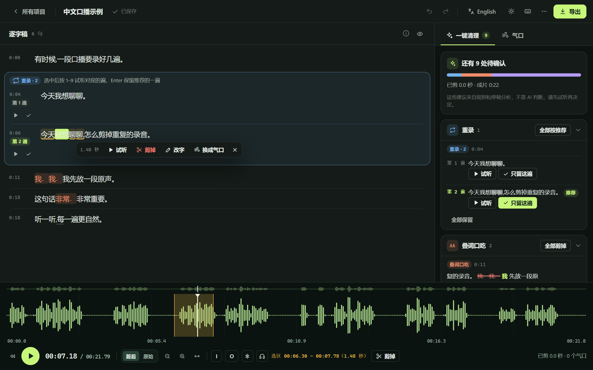

# 复听 Takecut

[English](README.md)

复听是给单人口播创作者用的本地剪辑台，靠逐字稿来剪。把录音拖进来，它会在你自己的电脑上转录，找出重录、口吃、语气词和长停顿，你可以逐条确认，也可以一键清理，最后导出音频和对齐的字幕。录音不会上传到任何地方。

参加 Devpost「Build Your First AI App 2026」的作品。



## 解决什么问题

一个人录口播，很少一遍就过：说到一半重来，卡在一个字上（「我，我，我…」），冒出「嗯」「呃」，或者想词时停太久。用通用剪辑软件清理，要对着波形一点点听、找到每次重来、剪掉、合拢，再重新对字幕时间。十分钟的稿子，清理可能比录音还久。

复听把录音转成带逐字时间的逐字稿，改文字就是剪声音：

- **一键清理**把可能要剪的地方分成四类：重录、叠词口吃、语气词、长停顿。每一条都能试听、应用、忽略，每一类也能一键处理。
- **重录**可以分别试听每一遍，再选一遍保留。默认推荐最后完整的一遍；同一句里的抢跑重说也能识别。
- **长停顿**按你设定的长度缩短，保留原来的环境底噪，接缝依然有呼吸感。
- 播放始终按剪后的结果走。导出的音频和字幕来自同一份剪辑，时间天然对齐。

适合用中文或英文给视频、播客、课程、短视频录口播的个人创作者，尤其是习惯一句录好几遍、想先快速粗剪再进剪辑软件的人。全程离线运行，没发布的录音不需要上传。

## 功能

**一键清理（右侧面板）**
- 重录：开头相同或大部分字相同的相邻句子，归为同一句的几遍。可以逐遍试听、保留一遍或全部保留。
- 抢跑重说：同一句里「今天我想今天我想聊聊」这种情况，剪掉放弃的开头。
- 叠词口吃：重复的短词（「我，我，我」「the the」）和说了一半的词（「th- the」）。
- 语气词：明确的（嗯、呃 / um、uh）和可能的（那个、就是 / like、you know，只有前后有停顿或标点时才算）。有声音却没识别出文字的片段也会列为「可能」。
- 长停顿：超过阈值（0.5–2 秒）的间隔，按剪后实际听到的长度计算。「缩短」会保留目标长度（0.2–0.8 秒）的原声底噪。
- 开头和结尾多余的静音。

**剪辑**
- 点词试听，拖选或 Shift 多选后，用浮动工具条剪掉、恢复、改字，或把选区换成气口。
- 改字：改正听错的词或词组，也能一次全部替换。只改字幕，不动声音。Whisper 把握不大的词带虚线下划线。
- 智能剪点：按词剪时，剪点自动落到附近最安静的位置，接缝落在静音里。
- 气口：在播放头插入 0.2 / 0.4 / 0.8 秒或任意长度的静音，可以拖动调整、循环试听，也能把原有停顿换成指定长度。
- 时间线有「剪后」视图（就是导出的样子，剪点用红线标出）和「原始」视图（完整录音，剪掉的部分标红）。单击定位、拖动选区、Ctrl+滚轮缩放，用总览条导航。
- 无限撤销和重做，剪辑自动保存。

**导出**
- 音频：WAV、MP3、M4A，由 FFmpeg 从原始音质的音源渲染，每个接缝 3 毫秒淡入淡出。可选响度标准化（播客 −16 LUFS、视频平台 −14 LUFS）和轻度降噪。
- 字幕：SRT、WebVTT 或纯文本，可设每条最多几个字、去掉标点（中文字幕常用），装了 OpenCC 还能简繁转换。

**其他**
- 项目保存在硬盘上，重启后还在。自带中文和英文示例项目。
- 中英双语界面，深浅色主题，快捷键（按 `?` 查看）。
- 只在本机运行：服务只监听 127.0.0.1，检查 `Host` 头，所有写操作都要带自定义请求头，页面带严格的内容安全策略（CSP）。

## AI 部分怎么实现

- **语音识别：OpenAI Whisper**，用 [faster-whisper](https://github.com/SYSTRAN/faster-whisper) 在本机运行。复听用到两个机器学习模型：Whisper 和 faster-whisper 自带的 Silero VAD（语音活动检测的小模型）；下面其余部分都是规则和信号处理。
  - `small` 模型任何 CPU 都能跑。`large-v3-turbo` 更准，能真正用上 CUDA GPU 时会默认选它；缺少 GPU 库就自动退回 CPU。
  - 转录在子进程里跑，显卡驱动出问题也不会拖垮整个程序。
  - 参数：`word_timestamps=True`；Silero VAD（`vad_filter`，faster-whisper 自带）；`condition_on_previous_text=False`（减少 Whisper 自己编出来的重复句）；按语言设置的 `initial_prompt`，里面故意写了语气词（「嗯，呃，那个…」/「Um, uh, so, like…」）。Whisper 习惯把口误省掉，这个提示词让它尽量保留，也让普通话输出简体字。
  - 每个词保留 Whisper 的置信度，用来给没把握的词加虚线。Whisper 单独输出的标点会并到前一个词上。
- **重录、抢跑、口吃、语气词的识别是启发式规则，不是 AI。** 它们在浏览器里根据 Whisper 的词运行，代码在 `web/js/core/suggest/`：
  - 重录：间隔 6 秒内的相邻句子，规范化后开头相同（至少 3 个字或 2 个英文单词，且占较短一句的 45% 以上），或者开头相同且最长公共子序列达到 80%。
  - 抢跑：一句话里 3 个字（2 个英文单词）以上的开头，紧接着又被大部分重说一次。
  - 口吃：同一个短词在 0.85 秒内重复，或以「-」结尾的半截词。
  - 语气词：按语言的词表；容易误判的词，只有前后都有停顿或标点时才算。
- **信号分析（DSP，不是 AI）**在 `takecut/analyze.py`。它计算 10 毫秒精度的响度包络，从中得到：真实的静音段（阈值在底噪和语音电平之间自适应）、有声音却没识别出文字的片段，以及智能剪点用的安静位置。
- **播放和渲染**是普通的信号处理：浏览器用 Web Audio API 按顺序播放原音频里保留的片段；服务器用 FFmpeg 按同一份片段列表逐帧精确渲染。

所有建议都要你确认，面板里也写明了这一点：规则可能漏掉改了说法的重录，Whisper 也可能听错字。

## 安装

需要 **Python 3.10 以上**、命令行能调用的 **FFmpeg 和 FFprobe**，以及现代桌面浏览器（Chrome、Edge、Firefox 或 Safari）。复听在 Windows 11 上开发和测试；服务端是纯 Python，理论上也能在 macOS 和 Linux 上运行，但还没测试过。

```powershell
py -3 -m pip install -r requirements.txt
py -3 -c "from faster_whisper import WhisperModel; WhisperModel('small', device='cpu', compute_type='int8')"
py -3 -m takecut --open
```

macOS 和 Linux 上把 `py -3` 换成 `python3`。Windows 上也可以直接双击 `start.cmd`。

- 编辑器地址是 `http://127.0.0.1:8769/`。端口被占用时加 `--port 8770`。用 `--data-dir <文件夹>` 可以换项目存放位置，默认在 Windows 的 `%LOCALAPPDATA%\Takecut`、macOS 的 `~/Library/Application Support/Takecut`、Linux 的 `~/.local/share/Takecut`。
- 第一次安装依赖和下载模型需要联网，之后可以完全离线使用。
- 没下载模型也能打开示例项目。
- 可选：`pip install opencc`，字幕就能简繁转换。
- 可选：Windows + NVIDIA 显卡想用 GPU 转录，需要 CUDA 12 的 cuBLAS 和 cuDNN 9（例如 `pip install nvidia-cublas-cu12 nvidia-cudnn-cu12`）。

## 试用

1. 在项目页点「打开中文示例」。
2. 在「一键清理」里展开「重录」，分别试听第 1 遍和第 2 遍，在更完整的一遍上点「只留这遍」。
3. 「叠词口吃」里剪掉「我，我，」；「非常，非常」是有意强调，点「全部保留」。
4. 「长停顿」里点「全部缩短」。
5. 按空格试听。播放头会跳过所有剪掉的地方，计时器显示的是剪后时间。
6. 点「导出」：音频选 MP3 和 −16 LUFS，字幕选 SRT，勾上「去掉标点」。

想剪自己的录音，把 WAV、MP3、M4A、MP4 拖到页面任何地方就行（最长 60 分钟，最大 512 MiB）。

### 快捷键

| 按键 | 作用 |
| --- | --- |
| 空格 | 播放 / 暂停 |
| ← / → | 播放头微调 0.05 秒（加 Shift：跳到上一个 / 下一个词） |
| I / O | 在播放头标入点 / 出点 |
| Delete 或 Backspace | 剪掉选区并合拢 |
| Ctrl+B | 在播放头分割 |
| / | 试听最近的剪点 |
| 1–9、Enter | 选中重录组后：试听第 N 遍、保留推荐的一遍 |
| Ctrl+Z / Ctrl+Shift+Z | 撤销 / 重做 |
| + / − | 缩放波形 |
| Ctrl+E | 导出 |
| ? | 查看全部快捷键 |

标记与波纹删除的键位参考 [DaVinci Resolve 官方入门指南](https://documents.blackmagicdesign.com/UserManuals/DaVinci-Resolve-17-Beginners-Guide.pdf)。

## 代码结构

```
takecut/            Python 标准库 HTTP 服务（不用 Web 框架）
  app.py            路由和安全检查（API 见 docs/api.md）
  projects.py       项目文件夹，JSON 原子写入
  jobs.py           转录和导出共用的单个后台任务线程
  transcribe.py     Whisper 子进程，GPU 失败自动退回 CPU
  analyze.py        响度包络、静音段、未识别的发声
  render.py         FFmpeg 滤镜图：裁切、静音、淡化、响度标准化、编码
web/                不需要构建，原生 ES modules
  js/core/          纯剪辑逻辑：时间轴换算、剪辑动作、建议规则、字幕
  js/audio/         Web Audio 播放引擎和波形峰值
  js/ui/            首页、编辑器、逐字稿、波形、一键清理、导出
tests/js            node --test（时间轴、建议规则、字幕、智能剪点）
tests/py            unittest（信号分析、渲染、HTTP API 端到端）
```

运行测试（不需要 `npm install`）：

```powershell
node --test "tests/js/*.test.js"
py -3 -m unittest discover -s tests/py -t .
```

## 我的贡献

我负责需求、工作流设计和测试：从自己的口播工作出发定义问题，决定试听重录、剪辑、气口和导出怎样衔接，挑选要沿用的 DaVinci Resolve 剪辑习惯，并在真实录音上测试每个版本、反馈问题和体验。

大部分代码由 AI 编程助手生成：**OpenAI Codex** 和 **Anthropic Claude**（Claude Code）。它们根据我的需求和反馈编写了 Python 服务端、浏览器编辑器、启发式建议规则和导出逻辑。

## 致谢

- 语音识别：[Whisper](https://github.com/openai/whisper)、[faster-whisper](https://github.com/SYSTRAN/faster-whisper)，以及 [Silero VAD](https://github.com/snakers4/silero-vad)。
- 解码、渲染、响度标准化和降噪：[FFmpeg](https://ffmpeg.org/)。
- 可选的简繁转换：[OpenCC](https://github.com/BYVoid/OpenCC)。
- 功能参考：Descript（去语气词、缩短停顿）、Gling（坏 take 复核）、剪映「智能剪口播」、Premiere Pro 文字剪辑，以及开源的 Audapolis 和 AutoCut。
- 两段示例录音由 Windows 语音合成生成，逐字稿是用复听自己的 Whisper 流程转录的。
